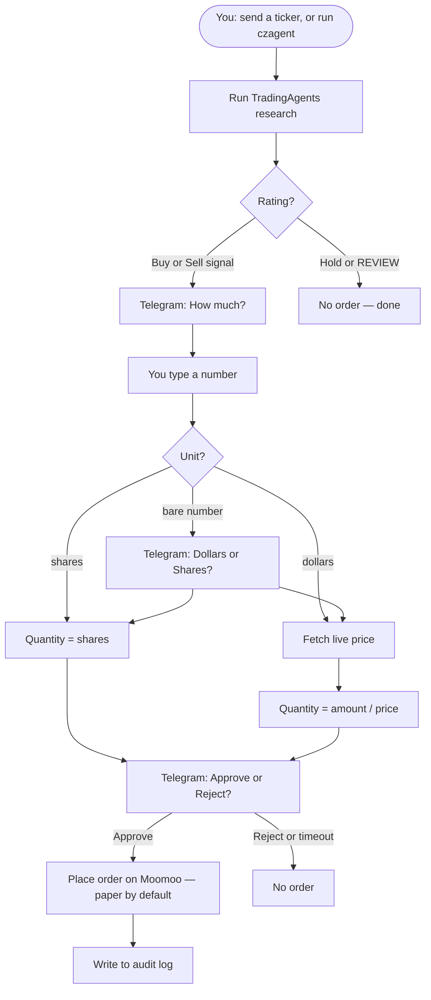
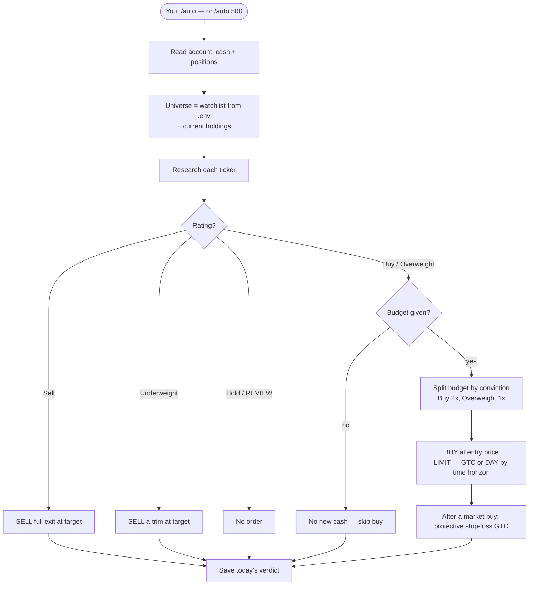

# Execution Agent

TradingAgents researches a stock and prints a decision, but it never *does*
anything with it. This agent closes that gap: it runs the research, then **asks
you on your phone** how much to trade and whether to go ahead — and only if you
tap **Approve** does it place the order.



The safety model is simple: **nothing reaches the broker unless you tap
Approve.** Timeout = reject, never a silent "yes."

## What you need

1. **Moomoo + OpenD** — the free gateway that lets your computer talk to Moomoo.
2. **A Telegram bot** — so you get the Approve/Reject message on your phone.
3. The two Python extras installed (see below).

## 1. Install

From the repo root, first activate the project's virtual environment, then install:

```bash
source .venv/bin/activate
pip install -e ".[execution]"
```

The `source` line puts you inside the project's Python environment — after it,
your prompt should start with `(.venv)`. If it doesn't, `czagent` won't be found.
Re-run that `source` line each time you open a fresh terminal.

This pulls in `moomoo-api` (the Moomoo SDK) and `python-telegram-bot` on top of
the normal TradingAgents install.

## 2. Set up OpenD (Moomoo's gateway)

1. Download **OpenD** from Moomoo's developer portal and launch it.
2. Log in with your Moomoo account (use a **paper** account to start).
3. Leave it running on `127.0.0.1:11111` (the default — don't change anything).
4. Keep OpenD running whenever you use this agent; it's the bridge to the broker.

## 3. Set up a Telegram bot (BotFather)

1. In Telegram, message **@BotFather** and send `/newbot`.
2. Follow the prompts; it gives you a **token** like `123456:ABC...`.
3. Send your new bot a message (any message — this lets it message you).
4. Get your **chat id** — a number. The quick way: message
   **@userinfobot** (it replies with your id), or run the agent once and watch
   its error message.

## 4. Configure

Put secrets in a `.env` file at the repo root (it's gitignored — **never commit
the token or chat id**):

```bash
# Required — from steps 2 and 3
EXECUTION_AGENT_TELEGRAM_BOT_TOKEN=123456:ABC-your-token
EXECUTION_AGENT_TELEGRAM_CHAT_ID=123456789

# Optional — these already have safe defaults
EXECUTION_AGENT_MOOMOO_HOST=127.0.0.1
EXECUTION_AGENT_MOOMOO_PORT=11111
EXECUTION_AGENT_TRADING_ENV=SIMULATE        # SIMULATE (paper) or REAL
EXECUTION_AGENT_APPROVAL_TIMEOUT_SECONDS=300
```

Every setting is optional except the two Telegram values.

## 5. Run it

```bash
source .venv/bin/activate
czagent run NVDA --date 2026-11-12
```

What happens, in order:

1. It runs the TradingAgents research for `NVDA`.
2. If the decision is Buy/Overweight/Sell/Underweight, it messages your phone:
   *"TradingAgents says BUY NVDA … How much do you want to trade?"*
3. You reply with a number — `500` (dollars) or `10 shares`. If you type a bare
   number, it asks a follow-up: **💵 Dollars** or **🔢 Shares**.
4. It shows the final order and an **Approve / Reject** pair of buttons.
5. **Approve** → it places the order on Moomoo (paper by default). **Reject** or
   no reply → nothing happens.

Useful flags:

| Flag | What it does |
|---|---|
| `--decide-only` | Run the research and print the decision — no Telegram, no order. |
| `--dry-run` | Run the whole approval flow but **do not** place the order. |
| `--portfolio book.json` | Feed in your positions so a SELL is capped at what you hold. |
| `--date YYYY-MM-DD` | The analysis date (required). |

## Run it from your phone (recommended)

Instead of typing the command each time, start a **persistent bot** and leave the
laptop running:

```bash
source .venv/bin/activate
czagent serve
```

(That first line activates the environment — skip it if your prompt already
shows `(.venv)`.)

Now you drive everything from Telegram:

1. Send a ticker — `NVDA`, `0700.HK`, or `/run NVDA`.
2. The bot runs the research, posting a one-line update on Telegram as each phase
   finishes (📊 market → 💬 sentiment → 📰 news → 🏦 fundamentals → ⚖️ debate →
   🎯 trader → 🛡️ risk → ✅ final), then asks *"How much?"* and dollars/shares,
   then **Approve / Reject**.
3. Tap **Approve** to place the order; the bot then goes back to listening for
   the next ticker.

One trade runs at a time. To stop the bot, press `Ctrl-C` in the laptop terminal.
This is the same flow as `run` — the only difference is *where* you start it.

### Fully-automatic `/auto` (paper only)

`/auto` is a **daily-budget manager**. It reads your account, researches the
universe, and acts by itself — no approval — but it *sizes by the research's
conviction*, not a fixed amount:

- **`/auto`** — "manage my account": research the watchlist + holdings and
  sell/trim/hold per the analysis, but deploy **no new cash**.
- **`/auto 500`** — "I have $500 today": split that budget across the buy ideas
  by conviction (`Buy` earns twice an `Overweight`), buy at the trader's entry
  price as a limit order, and place a protective stop-loss after a market fill.

The **"what to buy" list** is your *watchlist* (`.env` `EXECUTION_AGENT_WATCHLIST`)
**plus** your *current holdings*, read live from the account. So `/auto` manages
what you own and, when you give it a budget, deploys the new cash across the
watchlist ideas.



| Rating | Action |
|---|---|
| Buy / Overweight | BUY — split of the budget (Buy 2×, Overweight 1×) |
| Hold | no order |
| Underweight | SELL a **trim** (default half — see `AUTO_UNDERWEIGHT_TRIM`) |
| Sell | SELL a **full exit** |

Orders are **paper only**. It follows the research's own levels — buy at the
trader's entry price, sell at the portfolio manager's price target — as limit
orders (falling back to a market order when no usable level exists). After a
*market* buy it also places a protective stop-loss at the trader's stop level; a
pending limit buy just records the stop for a later run.

Limit orders rest on Moomoo's side, so they survive the bot being offline — and
the agent decides how long based on the research's own **Time Horizon**: a long
call ("3-6 months") places a **GTC** order (rests until filled or cancelled), a
short call ("1-2 weeks") places a **DAY** order. The protective stop-loss is
always **GTC**. Because GTC orders can linger, each fresh run first **cancels
the prior day's open orders** on each ticker before placing new ones, so a stale
limit can't double-fill or fire against a superseded verdict.

The verdict is saved to `~/.tradingagents/execution/auto_plan.json`, keyed by
date (with the day's `budget`). Run `/auto` again the same day and it reuses
that verdict; the next day it re-researches because the stored plan is stale.
Separately, if you already researched a ticker interactively today (e.g. a
morning `/run NVDA`), `/auto` reuses that same-day result instead of re-running
the full pipeline — it still fetches a fresh live quote to size the order. That
shared result lives in `~/.tradingagents/execution/research_history.json`.
`/auto` refuses to run in `REAL` mode — it is paper-only by design.

```bash
# Optional — which tickers /auto researches each day (unset: holdings only)
EXECUTION_AGENT_WATCHLIST=NVDA,AAPL

# Optional — an "Underweight" sell trims to this fraction of the position
EXECUTION_AGENT_AUTO_UNDERWEIGHT_TRIM=0.50
```

## How it maps decisions to orders

| TradingAgents rating | Action |
|---|---|
| Buy / Overweight | BUY |
| Sell / Underweight | SELL |
| Hold | no order |
| REVIEW | never trade |

Orders are **market** orders in the interactive flow — the quantity is the only
number sent, and *you* choose the quantity in chat. The agent never parses
numbers out of the LLM's prose there. `/auto` is the exception: it places
**limit** orders at the research's own structured levels (entry price / price
target), since those come from the trader and portfolio-manager schemas rather
than free text.

## Supported symbols

Stocks and ETFs on these markets map automatically:

| You type | Moomoo code |
|---|---|
| `NVDA` | `US.NVDA` |
| `0700.HK` | `HK.00700` |
| `600519.SS` | `SH.600519` |

Crypto, forex, futures, and indices are rejected (Moomoo conventions differ).

## Safety defaults (not optional)

- **Paper first**: `TRADING_ENV=SIMULATE` by default. `REAL` requires you to
  change it explicitly *and* have a live Moomoo account unlocked in OpenD.
- **Approve is opt-in**: timeout or Reject never places an order.
- **REVIEW is skipped**: an unreadable decision is never traded.
- **Secrets never logged**: the audit trail below records decisions and orders,
  never your token or chat id.

## Audit log

Every step is written to `~/.tradingagents/execution/audit.jsonl` — one JSON
object per line (`decision`, `amount`, `proposal`, `approval`, `order`, `error`).
Override the path with `EXECUTION_AGENT_AUDIT_PATH`.

## Tests

```bash
pytest tests/test_execution_agent_*.py
```

The unit tests block the network, so the Moomoo and Telegram SDKs are faked — no
OpenD or Telegram needed to run them.
